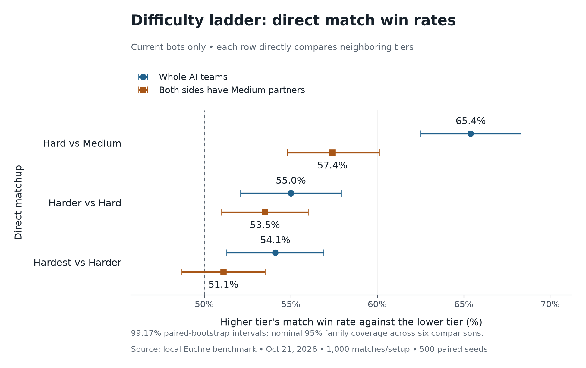
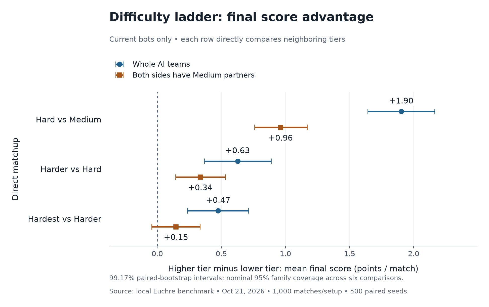

# Direct difficulty-ladder benchmark

October 21, 2026, America/Phoenix. This study compares the **current** Medium,
Hard, Harder, and Hardest bots directly. Each row pits one difficulty against
the difficulty immediately below it. These are not comparisons against old bots.

**Whole-team results support every step of the intended ladder.** With Medium
partners, Hard and Harder have clear advantages over the preceding tier, while
Hardest's advantage over Harder remains inconclusive. Medium → Hard is the
largest measured step; the upper-tier gains are smaller.

## Match win rates



Each percentage is the higher tier's win rate against its listed opponent.
There are 1,000 matches in each matchup/setup. Parentheses contain the adjusted
99.1667% paired-bootstrap intervals used in the graphs:

- **Hard vs Medium:** whole teams **65.4%** (62.5%–68.3%); Medium partners
  **57.4%** (54.8%–60.1%).
- **Harder vs Hard:** whole teams **55.0%** (52.1%–57.9%); Medium partners
  **53.5%** (51.0%–56.0%).
- **Hardest vs Harder:** whole teams **54.1%** (51.3%–56.9%); Medium partners
  **51.1%** (48.7%–53.5%).

Five of the six intervals sit entirely above 50%. The Hardest–Harder result with
Medium partners does not establish a meaningful strength difference. It is not
evidence that Harder is stronger, either. A future tuning effort should focus on
that separation and validate changes on a fresh seed set.

## Final score margins



Mean final score margins, with the corresponding adjusted intervals:

- **Hard vs Medium:** whole teams **+1.903** (+1.643 to +2.164); Medium
  partners **+0.962** (+0.759 to +1.170).
- **Harder vs Hard:** whole teams **+0.627** (+0.366 to +0.888); Medium
  partners **+0.335** (+0.143 to +0.532).
- **Hardest vs Harder:** whole teams **+0.475** (+0.236 to +0.713); Medium
  partners **+0.146** (−0.043 to +0.334), also inconclusive.

Positive margins favor the higher listed tier. These are final scores from
complete matches, averaged over wins and losses, not points per isolated hand.
Match win rate is the primary measure; score margins provide supporting detail.

## Study design

- Three direct matchups: Hard vs Medium, Harder vs Hard, Hardest vs Harder.
- Two setups per matchup: two bots of the listed difficulty per team, and one
  tested bot plus a Medium partner on each team.
- 500 paired seeds per matchup/setup. Each seed supplies two full matches with
  the tested sides swapped, for 1,000 matches per setup and 6,000 matches total.
  The same 500 seed values are reused across the six setups; they are not 3,000
  distinct seeds. The six-comparison adjustment does not require independence.
- Games run to ten points. Deal randomness is independent of decision randomness;
  each pair shares its initial deal/dealer and deterministic future deal sequence.
- Fresh seed `20261117`; fixed sample sizes selected before examining outcomes.
  Results from the earlier small ladder trials are not pooled into this study.
- The AI sources and settings match the larger old-versus-new study. No strategy,
  difficulty margin, sample budget, or endgame depth was retuned during this run.
- Hard uses 32 simulations and a 0.40-point switch margin; Harder uses 128,
  0.12, and two-trick search; Hardest uses 384, 0.04, and three-trick search.
- Benchmarks use 20 independent workers. Parallel wall-clock decision timings
  are diagnostic data, not a controlled latency comparison.

## Uncertainty and interpretation

The graphs use 100,000 bootstrap resamples of entire paired seeds, preserving
the correlation between the two matches in a pair. Intervals are 99.1667% each:
a Bonferroni adjustment for all six matchup/setup comparisons, providing nominal
95% family coverage for match win rates. Score-margin intervals use a separate
six-comparison adjustment; there is no joint coverage claim across both metrics.
The compact results also retain ordinary 95% intervals and the benchmark's
original 10,000-resample summaries.

A win-rate interval entirely above 50% supports the higher tier being stronger
in that matchup/setup. An interval containing 50% means the result is unresolved,
even if the point estimate favors the higher tier. The same interpretation
applies to zero for score margins. This tests the adjacent ladder; it is not an
all-pairs tournament or an estimate of human win rates.

Medium-partner games test a different lineup with one tested bot per side.
Whole-team games have two tested bots per side. Differences between these
setups do not isolate a causal effect of partner style. Whether a difficulty
jump feels comfortable still needs human playtesting.

## Data and reproduction

[Compact results and fingerprints](results.json) ·
[All 3,000 paired comparisons and 6,000 match results](paired-results.json.gz) ·
[Tested sources and compiled benchmark](source-snapshot.json.gz) ·
[Benchmark implementation and method](../../ai-benchmarks.md) ·
[Separate old-versus-new study](../large-study/README.md)

The archived raw report's `baseline` field identifies the available frozen
legacy source; this ladder run does not use it as an opponent. The compact
summary explicitly marks every candidate and opponent as current.

The source archive preserves the exact tested AI, engine, benchmark sources,
and the two compiled bundles used by the workers. Engine display-name changes
from concurrent game development do not enter this already compiled run. The
archived engine matches the recorded hash and the Git version at
`9247a0df4dfc188692189fd14a31a6c16b6a041e`.
Recompiling the archived sources reproduced both running bundles byte for byte.

```powershell
npm run benchmark:ai -- --pairs 500 --suite ladder --partners both --mode matches --workers 20 --details --seed 20261117 --output .local/ai-large-ladder.json
python scripts/plot-ai-ladder.py --matches .local/ai-large-ladder.json --output docs/benchmarks/difficulty-ladder
```

The plotter requires numpy and matplotlib. It checks all six comparisons are
present, verifies seed order, paired leg counts, winners, and reported averages,
then archives the exact raw report as compressed JSON. Source SHA-256 values
are recorded in both the raw and compact reports. Both figures have SVG copies.
