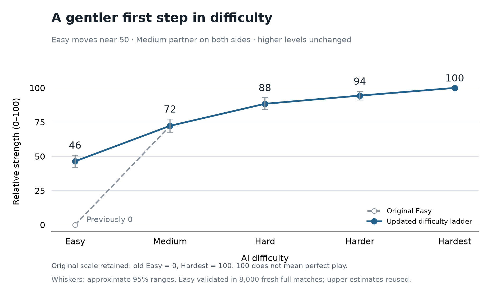

# Easy difficulty rebalance

Easy now mixes basic sensible card play with beginner mistakes. On 70% of play
and discard decisions it uses the existing Medium card policy; on the remaining
30% it chooses a random legal action. Random choices can still coincide with the
sensible move. Its bidding is unchanged: ordinary strong calls, no lone hands,
and a 12% chance of a loose call when the basic policy would pass. It uses no
hidden-card simulations. Medium, Hard, Harder, and Hardest are unchanged.



The original scale is retained: **original Easy = 0**, **Hardest = 100**. Updated
Easy measures **46.4** (approximate 95% range **42.0–51.0**), near the requested
50. The other estimates remain **72.3 / 88.4 / 94.4 / 100**. These are illustrative
relative ratings, not accuracy percentages or progress toward perfect play.
Only Easy was benchmarked again here; the upper estimates reuse previous data.

## Independent validation

The final check used **8,000 full matches**: 2,000 duplicate-deal pairs for each
Easy version against unchanged Medium, with a Medium partner on both sides.
Pairs exchange seats/teams, and deal randomness is independent of bot randomness.
Both versions use the same seed cohort, beginning at **20270221**.

Updated Easy won **36.05%** (pointwise 95% interval **34.98%–37.13%**), versus
**16.23%** (**15.20%–17.28%**) for frozen original Easy. The paired gain is
**19.83 percentage points** (**18.55–21.08**). Equivalently, Medium's win rate
fell from **83.78% to 63.95%**: a smaller, still clear step up to Medium.

One candidate was calibrated on 500 pairs from seed **20270203**, using absolute
distance from index 50 as the metric: baseline error **47.460**, candidate error
**0.187** (index **49.813**). The candidate was frozen at isolated revision
`99d161c` before validation. The fresh point estimate was lower; no retuning on
the validation results was performed. Validation seeds are disjoint from the
development and original rating cohorts.

Ranges use 25,000 whole-pair bootstrap resamples and are pointwise, not
simultaneous. Shared seeds are resampled together for the before/after gain.
The Easy index also resamples the original reference cohorts, preserving the
shared lower-tier cohort. It assumes transitive adjacent log win odds, so the
scale remains an approximate picture of spacing. The original rating graph and
all earlier Hardest studies are preserved.

## Reproduce

Run the current implementation from the repository root:

```powershell
npm run benchmark:easy -- --pairs 2000 --seed 20270221 --workers 8 --output .local/easy-benchmark.json
```

This compares current Easy and frozen original Easy against Medium. For a quick
check, use `--pairs 10`; `--current-only` skips the original control. The report
includes settings, source fingerprints and every paired result. Win-rate claims
are an offline benchmark, not a timing-sensitive unit test or CI threshold.

The [source snapshot](source-snapshot.json.gz) preserves exact source bytes and
both compiled entries used in validation, including the frozen control policy.
The archived engine also contains unrelated ongoing multiplayer work; this
Easy change did not edit the engine. The snapshot uses esbuild 0.25.12 / Node 22
target. To extract it and independently verify both compiled entries:

```powershell
node docs/benchmarks/easy-rebalance/analysis/replay-snapshot.mjs
```

Add `--run` to rerun all 8,000 matches from that verified snapshot. Extracted
files and results are written under `.local/easy-replay-<process-id>/`.
Both entries were independently rebuilt and matched byte for byte.

The [analysis script](analysis/plot-easy-rebalance.py) regenerates the summary
and figures with Python, NumPy and Matplotlib. It reads the archived results and
the preserved reference cohorts directly, checks paired counts and raw means,
and records input and analysis hashes in [summary.json](summary.json).

Verification: **223 tests passed**, TypeScript and production build passed.
Five new Easy tests cover conserving a winning trump, retaining mistakes,
discarding, normal rather than lone calls, and loose bidding. The existing
regression check still verifies unchanged Medium, Hard, and Harder decisions;
Hardest's implementation and dispatch are unchanged.

[Paired match outcomes](paired-results.json.gz) · [Exact summary](summary.json) ·
[Vector figure](relative-strength.svg)
