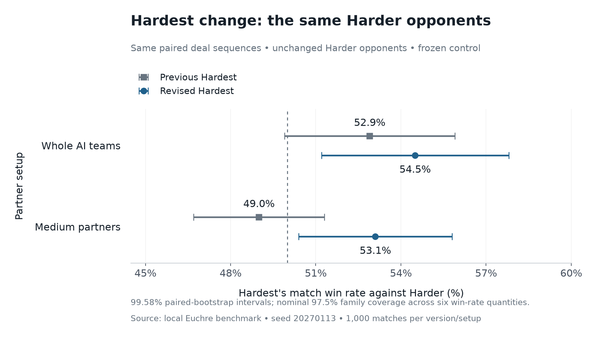
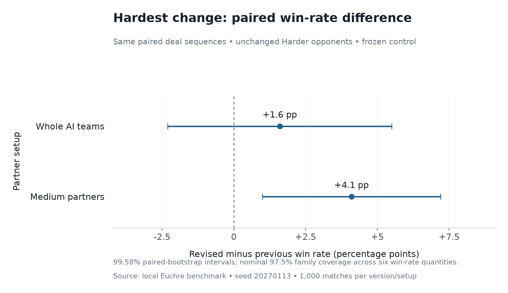
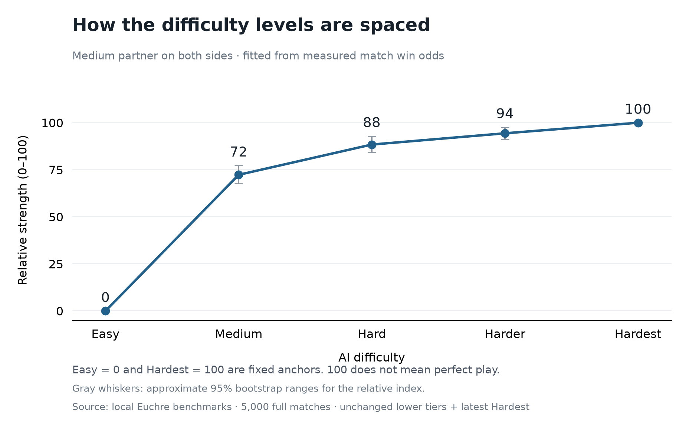

# Hardest follow-up: fresh validation

This is the separately frozen follow-up to the
[unsuccessful first strengthening attempt](../hardest-strengthening/README.md).
The fresh **4,000-match benchmark supports the declared target**: revised Hardest
beats Harder in both partner setups and improves over the previous Hardest with
a Medium partner. The advantage is modest; globally perfect play remains
unproven. No interim outcome selected the strategy or changed the sample size.
See the recorded
[validation plan](validation-plan.json) and [source freeze](freeze.json).

## Results

Against unchanged Harder, with adjusted 99.5833% paired-bootstrap intervals:

- **Medium partners:** revised Hardest won **53.1%** (50.4%–55.8%), versus
  **49.0%** (46.7%–51.3%) for the previous version. The paired improvement was
  **+4.1 percentage points** (1.0–7.2), supporting an improvement over the old
  Hardest and an advantage over Harder.
- **Whole teams:** revised Hardest won **54.5%** (51.2%–57.8%), versus **52.9%**
  (49.9%–55.9%) previously. The paired change was **+1.6 points** (−2.3 to +5.5).
  The Hardest-to-Harder ladder step is supported, while improvement over the
  previous whole-team Hardest remains inconclusive.

The supporting Medium-partner score-margin change was +0.264 points per match
(adjusted interval +0.002 to +0.526). The whole-team score-margin change was
−0.038 (−0.371 to +0.294), also inconclusive. Match wins remain the primary
measure; the score-margin result is not substituted for it.





[Exact numerical results](strengthening-results.json) ·
[Current paired matches](current-paired-results.json.gz) ·
[Control paired matches](control-paired-results.json.gz) ·
[Tested sources and compiled bundles](source-snapshot.json.gz) ·
[Initial-seed audit](seed-audit.json) ·
[Excluded startup log](discontinued-control-startup.log)

## Strategy selected before validation

Hardest still samples at most **384 hidden allocations**. Medium, Hard, and
Harder retain their existing decisions and budgets. The retained follow-up adds
consistent hypothetical original hand order when interpreting previous card
choices. It also favors future decisions that remain consistent across worlds
the player cannot distinguish: 75% information-set continuation over the final
three tricks, 25% partner-aware tactical forecast over the final two tricks.

Hardest also retains the first attempt's score-aware match objective, soft
inference from public bids and plays, simple/strategic player hypotheses, exact
tactical pruning, and shortcuts once the hand's score cannot change. Terminal
match wins are exact; future-hand equity and behavioral models are approximate.
The AI receives its own hand and public observations. Other hands, private
discards, actual player policies/difficulties and random generators are never
supplied. There is no claim of mathematically perfect hidden-information play.

## Fixed design

Seed **20270113** supplies **500 duplicate-deal pairs per case**, each with the
tested teams swapped. Each match plays to ten. Four cases total **4,000 matches**:
revised Hardest against unchanged Harder, and frozen pre-strengthening Hardest
against that same Harder, each with whole AI teams and Medium partners.

Both runs use the same immutable compiled build. The control selects the frozen
previous Hardest policy; its Harder opponent is identical to the revised run's.
Independent deal and decision random streams keep the paired deals comparable.
Different policies can require different numbers of hands to finish a match.
All cases reuse the same 500 initial seed values; 4,000 matches does not imply
4,000 independent seeds.

Current and control runs use 24 and 20 workers, respectively. Worker
scheduling affects concurrent decision timings, not the deterministic outcomes.
The comparison fixes hidden-deal budgets, rather than wall-clock computation.
The exact source and compiled bundles are archived. An independent rebuild
matched both compiled entries byte for byte. Both complete reports fingerprint
the same source files, and the primary checkout's AI and engine match that tested
snapshot.

The control initially used eight workers. It was restarted for resource balance
after logging 50 of 500 whole-team pairs, before any complete case or aggregate
result existed. That interrupted work is excluded. The restarted control replays
all 500 pairs per case using the identical frozen build, seeds and settings.

## Analysis

Match win rate is primary. Mean final score margin is supporting detail.
Analysis uses **100,000 whole-pair bootstrap resamples**, with the same indices
for before, after and their difference. Six quantities per metric are adjusted:
before, after and change, in each of the two partner setups. A stricter
**0.025 family error allowance** gives **99.5833% individual intervals** and
nominal **97.5% family coverage per metric**. Bootstrap coverage is approximate;
there is no joint coverage claim across both metrics or across the research
history.

An adjusted win interval wholly above 50% supports superiority to Harder. An
adjusted paired-change interval wholly above zero supports an improvement over
the previous Hardest against that fixed opponent. The declared target requires
both with Medium partners and retaining the whole-team ladder step. A positive
point estimate alone cannot establish either claim.

## Development and checks

The first attempt's seed 20261221 was reused only as **development data**. Its
first 300 paired seeds (600 mixed-partner matches) measured the follow-up's three
bounded trials: consistent latent order raised development wins from 51.8333%
to 53.0%; favoring information-consistent continuation raised them to 53.3333%;
policy-specific public-bid likelihood fell back to 53.0% and was discarded.
These selected the candidate and are excluded from final inference.

A separate development sanity check of 100 paired seeds/200 whole-team matches
won 56.5%; this is also excluded. The final source is isolated commit `fd028e0`,
whose AI bytes match retained trial `a23134c` after reverting the last experiment.
Experimental commits use the user's configured identity in an isolated local
repository; the shared multiplayer/UI checkout was preserved.

The selected source passed 73 game tests and TypeScript checks. After promotion,
the full primary project passed **218 tests in 25 files**, plus the production
build. Checks include independent actual-engine tactical oracles, shared
information-set decisions, a fixed sampling-budget guard, score-aware loner
decisions, latent-order regression tests, and unchanged lower-difficulty actions.
All tested AI helpers and the engine matched the primary checkout at freeze.

The historical lower-tier results remain in the
[first full-ladder validation](../hardest-strengthening/README.md) and the
[earlier difficulty-ladder study](../difficulty-ladder/README.md). They are not
pooled into this fresh top-tier comparison.

## Recompute the figures

The [exact analysis script](analysis/plot-hardest-strengthening.py) is saved with
this study. Decompress the two paired-match archives, then run it with Python,
NumPy and Matplotlib:

```powershell
python analysis/plot-hardest-strengthening.py --current current-paired-results.json --control control-paired-results.json --output figures --family-alpha 0.025
```

The summary records the input and analysis-script SHA-256 hashes. Development
and prior validation results are excluded from these estimates. Historical
studies remain unchanged.

## Relative difficulty scale

This original graph predates the [Easy rebalance](../easy-rebalance/README.md).
The updated graph retains its original anchors and moves Easy to approximately
46, with Medium and higher estimates unchanged.



This is an approximate **relative index**, with Easy fixed at **0** and Hardest
at **100**. The fitted intermediate values are Medium **72**, Hard **88**, and
Harder **94**. A score of 100 means the strongest current bot, not perfect play;
these numbers are not win percentages or an absolute skill rating.

The index adds adjacent log win odds, then normalizes their total gap to 100
(a Bradley–Terry / Elo-style construction). All matchups hold a Medium partner
constant on each side. The inputs are Medium/Easy **83.2%**, Hard/Medium **58.8%**,
Harder/Hard **53.3%**, and latest Hardest/Harder **53.1%**. The line connects
discrete difficulty levels; it does not imply intermediate bot settings exist.

This separate visualization uses **5,000 matches**: a new, inexpensive
2,000-match Medium/Easy calibration (1,000 paired seeds, seed 20270203), plus
1,000 saved mixed-partner matches for each remaining adjacent step. The lower
tiers are unchanged, so their existing measurements are reused. The new
calibration does not alter the original 4,000-match validation or its claims.
Its compiled worker matches the archived tested worker byte for byte.

Gray whiskers are pointwise 95% ranges from 25,000 whole-pair bootstrap
resamples, conditional on this rating model. Resampling preserves the two
lower comparisons' shared seed cohort; the other cohorts are independent.
The endpoints remain fixed in every resample. The model assumes transitive
strength, which adjacent matchups alone cannot establish, so use this as a
picture of relative spacing rather than a universal rating system.

[Exact index and uncertainty](relative-strength.json) ·
[New Medium/Easy paired matches](scale-easy-medium-pairs.json.gz) ·
[Reproducible scale analysis](analysis/plot-relative-strength.py)
