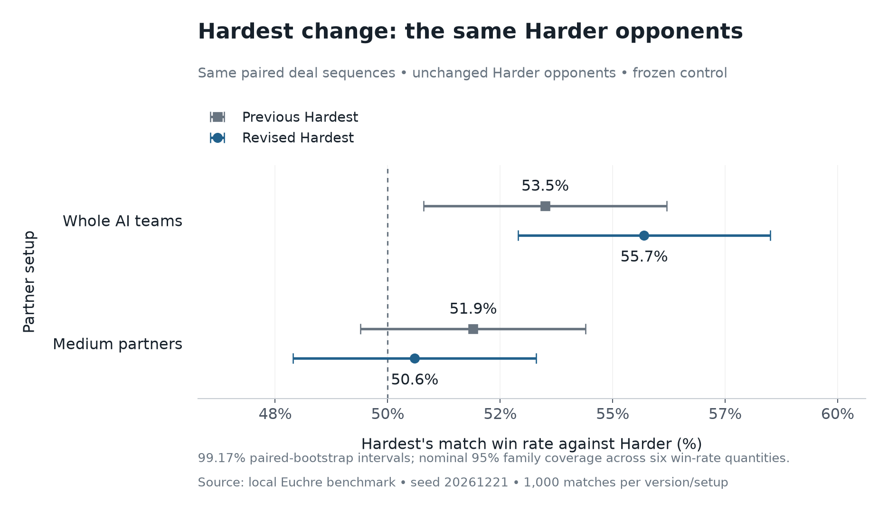
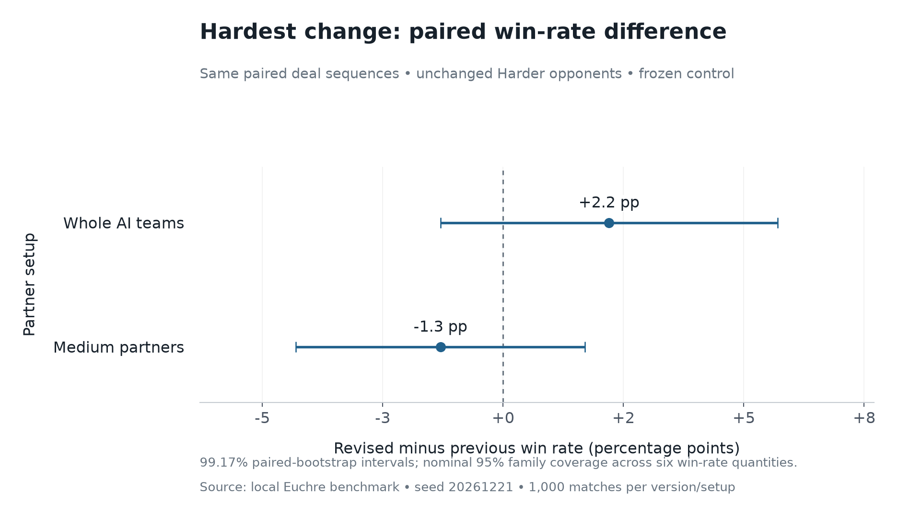
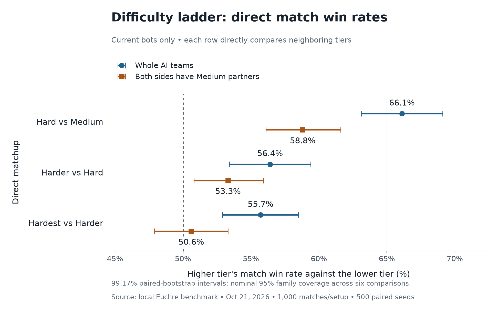

# Hardest strategy change: independent validation

This first candidate **did not establish the requested improvement with a
Medium partner**. All 8,000 analyzed matches are complete. This study keeps the historical
[previous ladder study](../difficulty-ladder/README.md) unchanged.

## Results

Against the same Harder opponents, with adjusted 99.1667% paired-bootstrap
intervals:

- Whole teams: revised Hardest **55.7%** (52.9%–58.5%), previous **53.5%**
  (50.8%–56.2%). Paired change **+2.2 percentage points** (−1.3 to +5.7).
- Medium partners: revised **50.6%** (47.9%–53.3%), previous **51.9%**
  (49.4%–54.4%). Paired change **−1.3 points** (−4.3 to +1.7).

Both before/after difference intervals cross zero. The current whole-team ladder
step is supported, while the Medium-partner Hardest–Harder separation remains
unresolved. The point estimate with Medium partners fell; this is not a successful
validation of that goal. Further development must use separate final validation
data rather than claiming a gain from the development sample.







[Matched results](strengthening-results.json) · [Complete ladder results](results.json) ·
[Current paired data](current-paired-results.json.gz) ·
[Control paired data](control-paired-results.json.gz) ·
[Both tested source and compiled snapshots](source-snapshot.json.gz) ·
[Initial-seed audit](seed-audit.json)

## What changed

Hardest retains its **384 sampled-deal budget**. Hard and Harder retain 32 and
128, and Medium's rules are unchanged. Lower-tier choices were checked against
the frozen pre-strengthening implementation through a complete seeded hand.

The revised Hardest combines:

- A match-score objective: a normal make at nine can be preferable to risking
  the match for a four-point lone hand. Terminal wins are exact; future match
  equity uses a neutral approximation, not a solved future game.
- Soft inference from public calls, passes, and card choices, while preserving
  proven voids as hard constraints. A broad prior prevents the policy model from
  turning a preference into certainty about a hidden card.
- A possible simple-playing partner. Four-trick tactical forecasts optimize our
  replies while letting that partner follow its own public-information policy,
  rather than relying on perfect cooperation. Other seats search optimal
  hypothetical replies. This component supplies 75% of the estimate.
- A three-trick information-set continuation for the remaining 25%. Our future
  choices are shared across worlds with the same observed play and own hand;
  sparse groups use a public policy rather than treating one sampled deal as
  knowledge of the real deal.
- Exact search bounds, promising-branch ordering, and skipping further analysis
  once the contract's score cannot change. These reduce computation without
  adding hidden-deal samples. Card sets use compact bit masks and cached card
  properties; partner-policy callbacks retain the original hand order.

The AI receives the same `Observation`: its own hand and known discard, plus
public play, bidding facts, card counts, scores, seats, and its own difficulty.
Other players' hands, private discards, actual bot policies/difficulties, and
decision random generators are not supplied. Player models are hypotheses. Hypothetical
minimax still assumes knowledge of one sampled allocation inside that forecast;
the overall strategy is not a proof of globally perfect imperfect-information
play.

## Fixed validation design

- Fresh seed **20261221**, fixed **500 paired seeds per matchup/setup**. Each
  supplies two full matches to ten points with the tested sides swapped.
- **6,000 current-ladder matches:** Hard vs Medium, Harder vs Hard, and Hardest vs
  Harder, each with whole AI teams and with a Medium partner on both sides.
- **2,000 control matches:** the frozen previous Hardest vs the same unchanged
  Harder, in both partner setups, on the identical seed sequence.
- All cases reuse the same 500 seed values. These are not 4,000 independent
  seeds. Deal randomness is independent of decision randomness; full matches
  share deterministic deal-sequence prefixes, although policies can change how
  many hands a match takes.
- Strategy and settings were frozen before validation. The engine, shared AI,
  Harder opponent, and frozen old-Hardest sources match byte for byte between the
  two builds. Only the current-Hardest `partner-search.ts` implementation differs;
  neither control bot calls it. The current ladder uses 24 workers and the
  control eight; scheduling affects wall-clock timings, not outcomes.
- The comparison holds sampled-deal budgets fixed, not wall-clock budgets.
  Deeper planning and evaluating two continuations require more computation.
- Development data are excluded from validation. No sample-size changes or
  retuning are made in response to the validation outcomes.

The control answers whether changing Hardest improved performance against a
fixed Harder opponent. A direct new-vs-old game would test a different opponent
and would not, by itself, establish the intended Hardest-to-Harder separation.

The current ladder was restarted for an implementation-only speed improvement,
before any upper-tier aggregate result was available. No strategy parameters or
sample sizes changed. The discontinued run's duplicate lower-tier results and
incomplete upper-tier work are excluded from inference. The old-Hardest control
continued because its policies were unaffected. Both complete builds are archived
separately and independently rebuilt for verification.

## Analysis

Match win rate is primary. Mean final score margin is supporting detail.
Whole paired seeds are bootstrapped 100,000 times, preserving correlation between
the swapped-team matches. The before/after analysis also uses the same bootstrap
indices for both versions, so the difference retains their pairing.

The ladder adjusts across its six matchup/setup comparisons. The before/after
analysis adjusts across six quantities: previous, revised, and difference in
each of the two partner setups. Each displayed interval is **99.1667%**, giving
nominal **95% family coverage per analysis and metric**. There is no combined
95% coverage claim across both analysis families or across win rates and score
margins. Percentile-bootstrap coverage is approximate.

An interval wholly above 50% supports superiority to Harder; a paired difference
interval wholly above zero supports improvement over the previous version.
Intervals crossing those references leave the corresponding question unresolved.
Neither a positive point estimate nor a development gain alone establishes it.

## Development selection and correctness

Development followed a bounded eight-trial
[Autoresearch 2.2.2 metric-loop protocol](https://github.com/uditgoenka/autoresearch).
Experimental history was kept in an isolated local repository, preserving
concurrent multiplayer/UI work in the shared checkout.

All development trials used seed 20261202, 150 paired seeds with Medium partners
against Harder. The development baseline was already an exploratory revision,
not the previous released Hardest: it scored **50.33%**. Partner-policy tactical
forecasts raised that to **51.67%**, and four-trick planning to **52.67%**. The
frozen previous Hardest scored **50.67%** on those training deals. These are
selection measurements, not independent evidence of an improvement.

Three of eight trials were retained and five discarded. Dealer-call inference
tied the metric while adding complexity. Posterior resample-move refinement,
removing play-choice evidence, using only the tactical forecast, and modeling
simple opponents underperformed the incumbent on the fixed development set.
Exact optimizations reproduced all 300 incumbent match outcomes and decision
counts; concurrent mean decision time fell from 185.3 ms to 164.6 ms. This timing
comparison is diagnostic rather than a controlled latency benchmark.

The compact solver matched 256 tactical comparisons, 16 independent rules-engine
oracles, and 253 complete AI decisions spanning both bidding rounds, discarding,
and playing. In that alternating-order replay, total decision time was 128.3 s
for the array implementation and 64.3 s for the compact implementation (1.99×).
This is a diagnostic run under concurrent load, not a controlled production
latency benchmark.

The primary project passed **191 tests** and its production build. Independent
rules-engine oracles check tactical search through four-trick endings, normal
and lone hands, every modeled-partner seat with both simple and strategic
policies, partially played tricks, information-set choices across
indistinguishable hidden worlds, and input immutability. Other checks cover
score-aware bidding, the shared sample budget, settled-score shortcuts, legal
full games, and unchanged lower-tier decisions.

See the [experiment log](../../../autoresearch/loop-261021-2054/results.tsv) and
[development-loop review](../../../autoresearch/loop-261021-2054/evals-summary.md).

## Reproduction

With the tested AI sources and installed web dependencies:

```powershell
npm run benchmark:ai -- --pairs 500 --seed 20261221 --suite ladder --partners both --mode matches --workers 24 --details --output .local/heldout-current.json
npm run benchmark:ai -- --pairs 500 --seed 20261221 --suite controls --partners both --mode matches --workers 8 --details --output .local/heldout-control.json
python scripts/plot-ai-ladder.py --matches .local/heldout-current.json --output docs/benchmarks/hardest-strengthening
python scripts/plot-hardest-strengthening.py --current .local/heldout-current.json --control .local/heldout-control.json --output docs/benchmarks/hardest-strengthening
```

The plotters require numpy and matplotlib. They validate complete comparison
sets, seed order, both legs, winners, and raw-vs-reported averages before plotting.
The matched before/after plotter additionally requires identical sample sizes
and seeds, plus matching engine/shared-policy/baseline fingerprints. It permits
only the recorded current-Hardest-only solver implementation difference and
rejects changes to any shared or control-policy source. Independent source and
compiled-bundle verification reproduced both tested builds byte for byte. All
4,000 lower-tier match outcomes, decision counts, and redeals also match the
discontinued build exactly. Its [duplicate data](discontinued-lower-results.json.gz)
are retained for the restart audit and excluded from inference.
