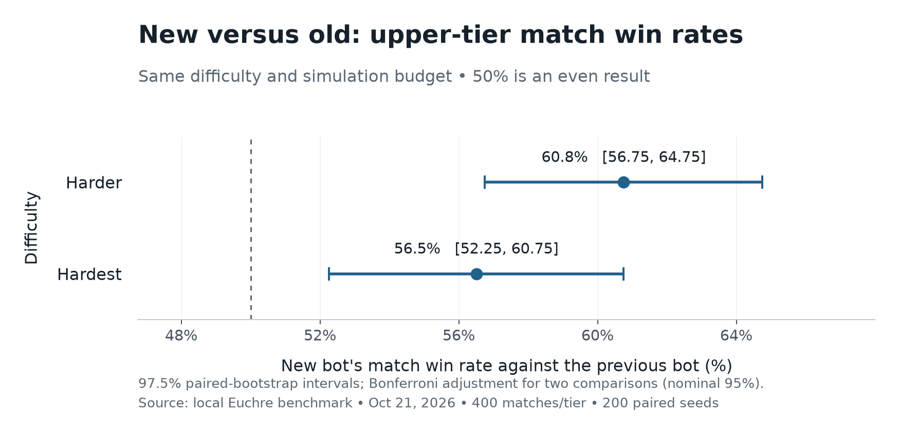
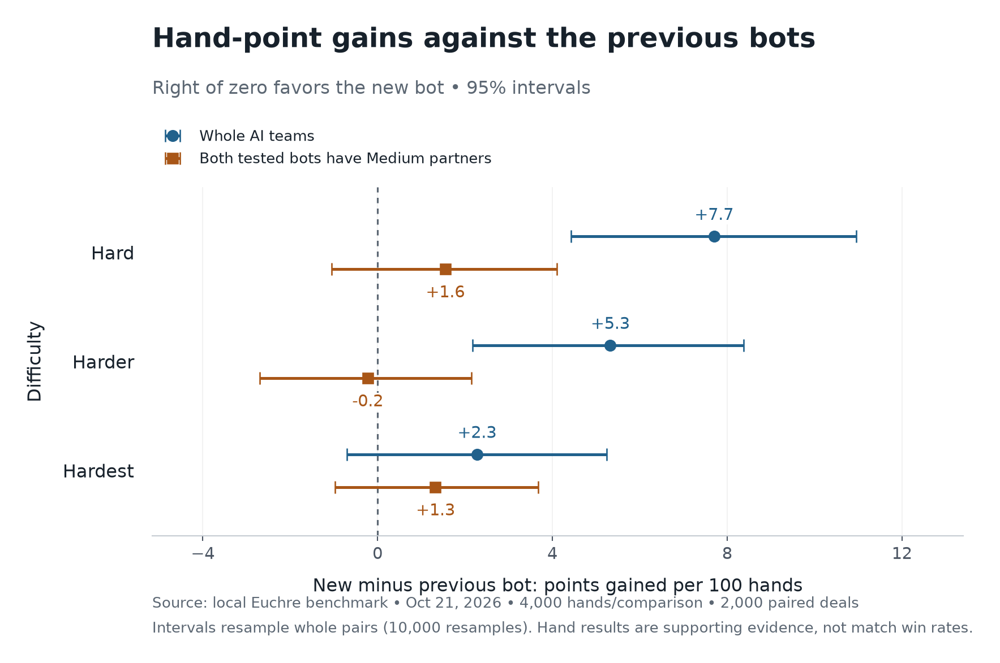

# Larger old-versus-new benchmark

October 21, 2026, America/Phoenix. AI settings were fixed for the entire study.

**Both new upper tiers won more complete matches than their corresponding old
bots.** Harder won 243 of 400 matches (60.75%); Hardest won 226 of 400 (56.5%).
The improvement is established for these whole-team matchups. It is not a claim
about human win rates, every partner style, or how new Harder compares to new
Hardest.

## Complete matches: primary comparisons



- **Harder vs old Harder:** 60.75% wins; 97.5% paired-bootstrap interval
  **56.75%–64.75%**. Mean final score advantage **+0.915 points per match**;
  97.5% interval **+0.5125 to +1.3125**.
- **Hardest vs old Hardest:** 56.5% wins; 97.5% interval **52.25%–60.75%**.
  Mean score advantage **+0.8125 points per match**; 97.5% interval
  **+0.425 to +1.195**.

Each comparison used 200 seed pairs, replayed with the teams swapped: 400
matches per tier, 800 matches total. A match ends at ten points. The two win-rate
comparisons are the primary tests; their 97.5% intervals provide nominal 95%
family coverage through a Bonferroni adjustment. Both exclude the 50% baseline.

## Individual hands: supporting evidence



Each of the six comparisons used 2,000 duplicate-deal pairs, or 4,000 hands:
24,000 isolated hands in total. Values below are new-minus-old points per 100
hands, with 95% paired-bootstrap intervals.

Whole teams (two tested bots per side):

- Hard: **+7.70**, interval **+4.425 to +10.95**.
- Harder: **+5.325**, interval **+2.175 to +8.375**.
- Hardest: **+2.275**, interval **−0.70 to +5.25**; inconclusive.

Medium partners (one tested bot plus one Medium partner on each side):

- Hard: **+1.55**, interval **−1.05 to +4.10**.
- Harder: **−0.225**, interval **−2.70 to +2.15**.
- Hardest: **+1.325**, interval **−0.975 to +3.675**.

None of the Medium-partner intervals excludes zero. The whole-team and mixed
setups change both the partner and the number of tested bots per team, so these
values should not be interpreted as an isolated causal partner effect.

Hardest's hand-point comparison remains uncertain despite its positive match
result. These are different metrics on different seed sets: isolated hands stop
after one hand, while complete games run to ten. The primary match results
support improved match strength; the hand results do not demonstrate a universal
point-scoring improvement under every setup.

## Controls, data, and reproduction

- The old bot is the frozen implementation from commit
  `9247a0df4dfc188692189fd14a31a6c16b6a041e`.
- Same simulation budgets: Hard 32, Harder 128, Hardest 384. Comparisons use equal
  sample budgets, not equal wall-clock time. Parallel timing data is not a
  controlled latency comparison.
- Source hashes match the AI and engine evaluated in the earlier small study;
  no AI strategy or difficulty settings were changed for this expanded run.
- Fresh seeds: `20261027` for isolated hands and `20261028` for complete matches.
  Sample sizes were fixed before the runs; these data were not used to retune.
- Each paired seed swaps the tested teams. Dealing and decision randomness are
  separate. Full matches share a deterministic sequence of future deals.
- Intervals resample entire pairs 10,000 times, retaining the correlation between
  replays. Worker scheduling does not affect games; serial and four-worker
  outputs were checked for identical seeds, points, winners, and redeals.
- Raw pairs were independently checked for unique seeds, complete leg counts,
  and agreement with the reported point and win averages.
- This compares the bundled changes; it does not isolate the effect of smarter
  rollouts, pass evaluation, difficulty margins, or endgame search individually.

[Compact results and source fingerprints](results.json) ·
[All paired results, compressed JSON](paired-results.json.gz) ·
[Benchmark commands and methodology](../../ai-benchmarks.md)

The PNG figures have editable SVG counterparts alongside them. To reproduce:

```powershell
npm run benchmark:ai -- --pairs 2000 --suite regression --partners both --workers 12 --details --seed 20261027 --output .local/ai-large-hands.json
npm run benchmark:ai -- --pairs 200 --suite regression --levels harder,hardest --partners teams --mode matches --workers 8 --details --seed 20261028 --output .local/ai-large-matches.json
python scripts/plot-ai-benchmark.py --hands .local/ai-large-hands.json --matches .local/ai-large-matches.json --output docs/benchmarks/large-study
```

Plot generation requires matplotlib. The reusable benchmark supports 1–32 CPU
workers; use a count appropriate for the machine. All 142 project tests passed
after the benchmark changes.
